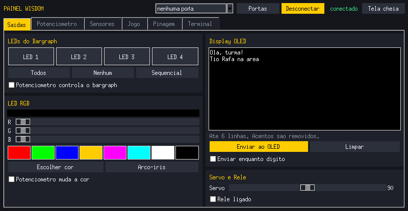
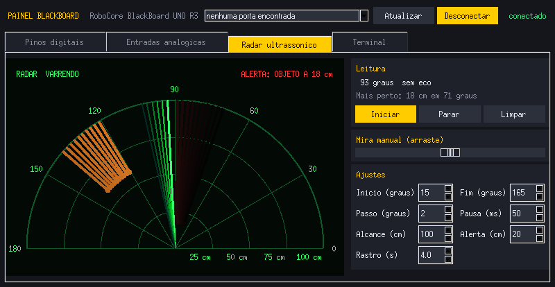
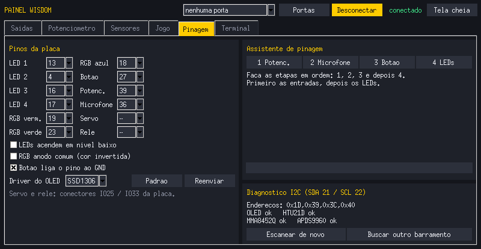
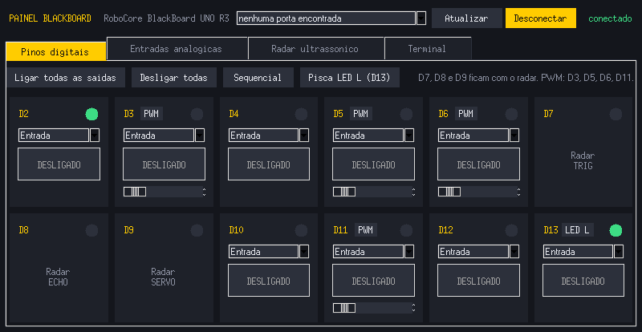

# Painéis RoboCore

Telas de controle em Python para duas placas da RoboCore: a **BlackBoard Wisdom** (ESP32) e a **BlackBoard UNO R3** (ATmega328P). Você liga e desliga LEDs, lê sensores, escreve no display, mexe no potenciômetro e vê tudo acontecer na tela. A BlackBoard ainda tem um **radar ultrassônico** com servo motor.

As duas placas moram dentro do **BIG-S**, o cyberdeck do Tio Rafa: um Raspberry Pi 5 com tela de 7" montado numa maleta. Por isso os painéis foram feitos para caber em **800x480**, mas também funcionam no computador, com Windows, Linux ou macOS.

| BlackBoard Wisdom | BlackBoard UNO R3 + radar |
|---|---|
|  |  |
|  |  |

*Capturas em 800x414 (tela de 7" com barra de tarefas), geradas com uma placa simulada.*

## Como funciona

```
 Computador / Raspberry Pi                  Placa RoboCore
 +---------------------------+              +------------------------+
 | painel_*.py               |  USB 115200  | firmware na placa      |
 | Tkinter + PySerial        | comandos ->  | Arduino ou MicroPython |
 |                           | <- leituras  |                        |
 +---------------------------+              +------------------------+
```

O firmware na placa só obedece comandos de texto, como `LED,0,1` ou `RGB,255,0,0`, e manda as leituras dos sensores. Toda a parte visual fica no Python. Os protocolos estão no LEIAME de cada pasta, para quem quiser estudar ou criar a sua própria tela.

## O que tem aqui

| Pasta | Placa | O que faz |
|---|---|---|
| [`wisdom/`](wisdom/) | BlackBoard Wisdom (ESP32) | LEDs do bargraph, LED RGB, display OLED, potenciômetro com robô animado, botão, microfone, temperatura e umidade, luz e proximidade, acelerômetro com nível de bolha, jogo Pega-Bolinha e assistente que descobre a pinagem sozinho |
| [`blackboard/`](blackboard/) | BlackBoard UNO R3 | Liga e desliga D2 a D13 (saída, entrada ou entrada com pull-up), PWM, leitura de A0 a A5 com gráfico, e radar com HC-SR04 sobre servo |

A Wisdom tem dois firmwares, à sua escolha: **Arduino IDE** ou **MicroPython**. Os dois funcionam com a mesma tela.

## Começo rápido

1. Grave o firmware na placa. O passo a passo está no LEIAME da pasta.
2. Instale o Python com Tkinter e o PySerial.
   - **Raspberry Pi:**
     ```
     sudo apt install python3-tk python3-serial
     sudo usermod -aG dialout $USER     # saia e entre de novo na sessao
     ```
   - **Windows/Thonny:** Ferramentas > Gerenciar pacotes > `pyserial`.
3. Rode o painel:
   ```
   python3 wisdom/painel_wisdom.py
   python3 blackboard/painel_blackboard.py
   ```
4. Escolha a porta e clique em **Conectar**. **F11** liga a tela cheia.

## Pinagem da BlackBoard Wisdom

A RoboCore não publica a pinagem da Wisdom em texto. Esta tabela foi descoberta com o assistente do painel numa placa real:

| Componente | GPIO |
|---|---|
| LEDs do bargraph 1 a 4 | 13, 4, 16, 17 |
| LED RGB (vermelho, verde, azul) | 19, 23, 18 |
| Botão (liga ao GND) | 27 |
| Potenciômetro deslizante | 39 |
| Microfone | 36 |
| I2C: OLED, HTU21D, MMA8452Q, APDS-9960 | SDA 21 / SCL 22 |
| Conectores de servo e relé | IO25 / IO33 |

## Status

| Parte | Situação |
|---|---|
| Painel Wisdom + firmwares v2.1 | testado numa Wisdom real no Raspberry Pi com tela de 7"; o firmware Arduino compila nos cores ESP32 3.3.2 e 2.0.17 |
| Painel BlackBoard + radar | tela usada numa BlackBoard UNO R3 real no cyberdeck; o firmware compila com o core AVR oficial (10 KB de flash, 629 B de RAM) |

## Autor

**Tio Rafa** (Rafael de Souza Oliveira): professor, palestrante e desenvolvedor de robótica educacional.

- Site: [tiorafa.tec.br](https://tiorafa.tec.br)
- YouTube, Instagram e TikTok: @prof.tiorafa

BlackBoard, BlackBoard Wisdom e BRIICK são produtos da [RoboCore](https://www.robocore.net). Este projeto é independente e não é oficial da RoboCore.
